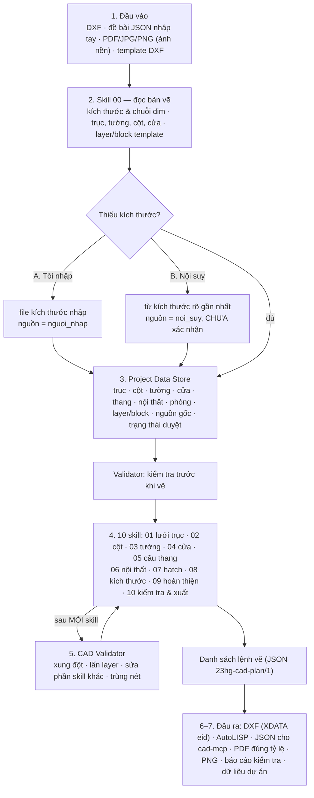

# QUY TRÌNH 16: DỰNG BẢN VẼ CAD TỰ ĐỘNG (AGENT DỰNG CAD)

Kiến trúc: **1 Master Agent + Skill 00 + 10 skill + CAD Validator + xuất AutoCAD (DXF / AutoLISP / JSON cho máy chủ MCP)**.
Tư duy cốt lõi: **đọc 1 lần → lưu dữ liệu chung → vẽ theo từng skill → kiểm tra liên tục**. Lõi tính tất định bằng Python,
không có LLM. Mã nguồn `tools/cad_drafting/`, hướng dẫn dùng `skills/aec-cad-drafting/SKILL.md`.

## 1. Đầu vào

| Loại | Dùng làm gì | Ghi chú |
|---|---|---|
| Đề bài JSON (schema `23hg-cad-store/1`) | Nguồn dữ liệu | Số liệu đọc từ PDF/ảnh gõ vào đây, ghi `[Trang N]` + số hiệu bản vẽ ở `nguon_mac_dinh` |
| DXF | Nguồn dữ liệu | Nhận diện theo tên layer (trục / tường / cột / cửa / dim) — mẫu regex trong `reader.DEFAULT_ROLE_PATTERNS` |
| PDF, JPG, PNG | Ảnh nền tham chiếu | KHÔNG tự nhận dạng số (cấm đoán số OCR mờ) |
| Template DXF | Layer, block của đơn vị | DWT/DWG cần AutoCAD — lưu template dạng DXF |
| DWG | — | Từ chối kèm hướng dẫn: mở bằng AutoCAD/cad-mcp hoặc chuyển DXF |

Chỉ một nguồn dữ liệu (JSON hoặc DXF) mỗi lần chạy.

## 2. Skill 00 và kích thước thiếu

- Thiếu kích thước → để trống (None), liệt kê ở `store.missing()`. Đối tượng phụ thuộc (tường trên trục chưa có toạ độ...) không vẽ và
  được ghi lý do.
- **A. Tôi nhập**: file `--kich-thuoc-nhap` mục `gia_tri`. Xác nhận số liệu đã nội suy là bước SAU: chạy lại trên
  `<tên>_du_lieu_du_an.json` với file chỉ có mục `xac_nhan` (người xác nhận ghi tên).
- **B. Nội suy** (`--noi-suy`): nhịp trục thiếu đúng một = kích thước tổng − tổng nhịp đã biết; kích thước cột/cửa lấy từ đối tượng cùng ký hiệu.
  Giá trị nội suy mang nguồn `noi_suy`, `confirmed = False`; trạng thái dữ liệu thành `CHO_XAC_NHAN_NOI_SUY`; khung tên và báo cáo ghi rõ;
  layer `KT-KIEM-TRA` (không in) đánh dấu vị trí. **Không có đường nào tự chuyển nội suy thành đã xác nhận.**

## 3. Project Data Store

`<tên>_du_lieu_du_an.json` — đọc lại được làm đầu vào cho lần sau (vấn đề phát hiện ở lần đọc trước không nạp lại: mọi
phát hiện tính lại từ dữ liệu hiện tại). Mỗi số liệu có nguồn gốc. Trạng thái duyệt tính bằng `store.status()`:
`THIEU_KICH_THUOC` → `CHO_XAC_NHAN_NOI_SUY` → `CHO_DUYET` → `DA_DUYET` (chỉ khi có phê duyệt mang đúng mã băm dữ liệu hiện tại;
sửa dữ liệu sau khi duyệt thì phê duyệt cũ hết hiệu lực). CLI chỉ ghi phê duyệt (`--duyet`) khi kết luận đã ĐẠT.

## 4. 10 skill

| Mã | Skill | Layer (vai trò) | Đọc dữ liệu |
|---|---|---|---|
| 01 | Lưới trục | KT-TRUC, KT-TRUC-KH | axes |
| 02 | Cột | KC-COT | axes, columns |
| 03 | Tường (trừ ô cửa, cột) | KT-TUONG | axes, columns, walls, openings |
| 04 | Cửa đi, cửa sổ, ký hiệu | KT-CUA, KT-CUA-KH | axes, walls, openings |
| 05 | Cầu thang | KT-THANG | axes, stairs |
| 06 | Nội thất (thư viện block + template) | KT-NOI-THAT | axes, furniture, blocks |
| 07 | Hatch cột, tường, sàn (chừa vế thang, vết nội thất) | KT-HATCH | axes, columns, walls, openings, rooms, stairs, furniture, blocks |
| 08 | Kích thước 3 cấp, 4 phía (DIMENSION nguyên bản, dimstyle TCVN) | KT-DIM | axes, walls, openings, columns |
| 09 | Tên phòng, diện tích, cote, bảng hoàn thiện (nhãn tránh đồ, thang, cửa, chữ khác) | KT-HOAN-THIEN | axes, rooms, walls, columns, furniture, blocks, stairs, openings |
| 10 | Khung bản vẽ, khung tên, đánh dấu kiểm tra | KT-KHUNG-TEN, KT-KIEM-TRA | tất cả |

Cột "đọc dữ liệu" lấy từ thuộc tính `reads` của từng skill — Master dùng nó cho chế độ `--cap-nhat`.

## 5. CAD Validator

- Trước khi vẽ (`precheck`): nhịp ≤ 0, tổng nhịp lệch kích thước tổng, tham chiếu trục sai, cửa vượt/chồng trên tường, phòng chồng nhau,
  kích thước nguồn ghi đè lệch số đo, thiếu kích thước, nội suy chưa xác nhận.
- Sau mỗi skill (`check_step`): lấn layer, sửa phần skill khác (so dấu vân tay), trùng nét, và kiểm tra riêng từng skill (cột chồng, tường trùng,
  cửa đè cột, cánh cửa vướng, thang đè tường, nội thất đè tường/cột/thang/chắn cửa, hatch hỏng biên, dim bằng 0, nhãn ngoài phòng, nội dung
  ngoài khung, chữ đè chữ).
- Cuối (`check_final`): đối tượng chưa vẽ, thiếu kích thước, nội suy chưa xác nhận.
- Kết luận **ĐẠT** = không LỖI, không NGHI VẤN, không đối tượng nào chưa vẽ — vẫn chỉ là "chờ kỹ sư duyệt".

## 6. Xuất AutoCAD 2026 / MCP

- DXF R2018, đơn vị mm, dimstyle `TCVN_KT_<tỷ lệ>`, font `VN_ARIAL`; XDATA `23HG_CAD` = eid trên từng thực thể. Master đọc lại DXF và so số
  thực thể từng layer với danh sách lệnh vẽ.
- AutoLISP (`23HG_VE`): thuần ASCII, chữ tiếng Việt dạng `\U+XXXX`. Mới kiểm tra cú pháp tĩnh, **chưa chạy thử trên AutoCAD**.
- JSON `*_lenh_ve.json`: giao cho máy chủ MCP điều khiển AutoCAD. Giao thức phía máy chủ `cad-mcp` (repo riêng) chưa được đối chiếu.
- DWG: không sinh trực tiếp (cần AutoCAD).

## 7. Đầu ra

Mọi file mang tên gốc `<tên>` (mặc định = số hiệu bản vẽ, đổi bằng `--ten`): `<tên>.dxf`, `<tên>.pdf` (đúng tỷ lệ theo khổ
giấy khi khung bản vẽ đặt được), `<tên>.png` (hiện cả layer kiểm tra), `<tên>.lsp`, `<tên>_lenh_ve.json`, `<tên>_du_lieu_du_an.json`,
`<tên>_BAO_CAO_KIEM_TRA.md` + `<tên>_bao_cao_kiem_tra.json`. Ví dụ chạy trên đề bài mẫu: `examples/DUNG_CAD_NHA_MAU/`.
